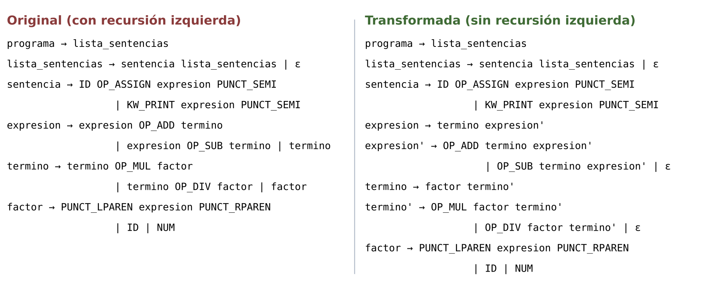
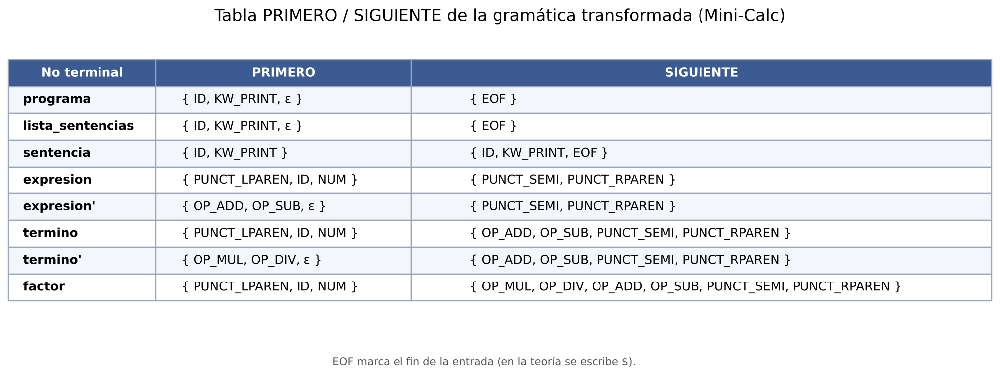
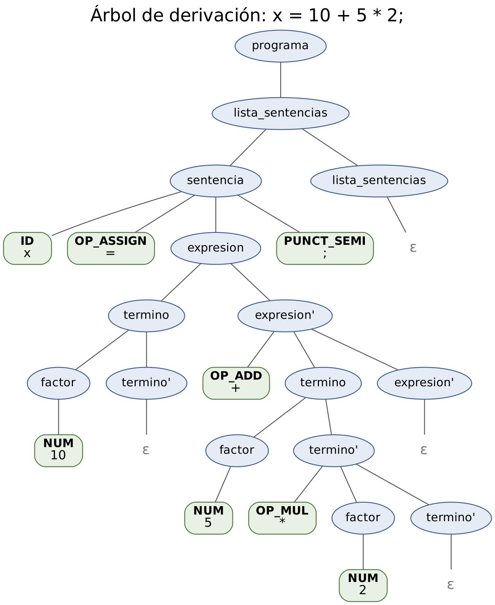
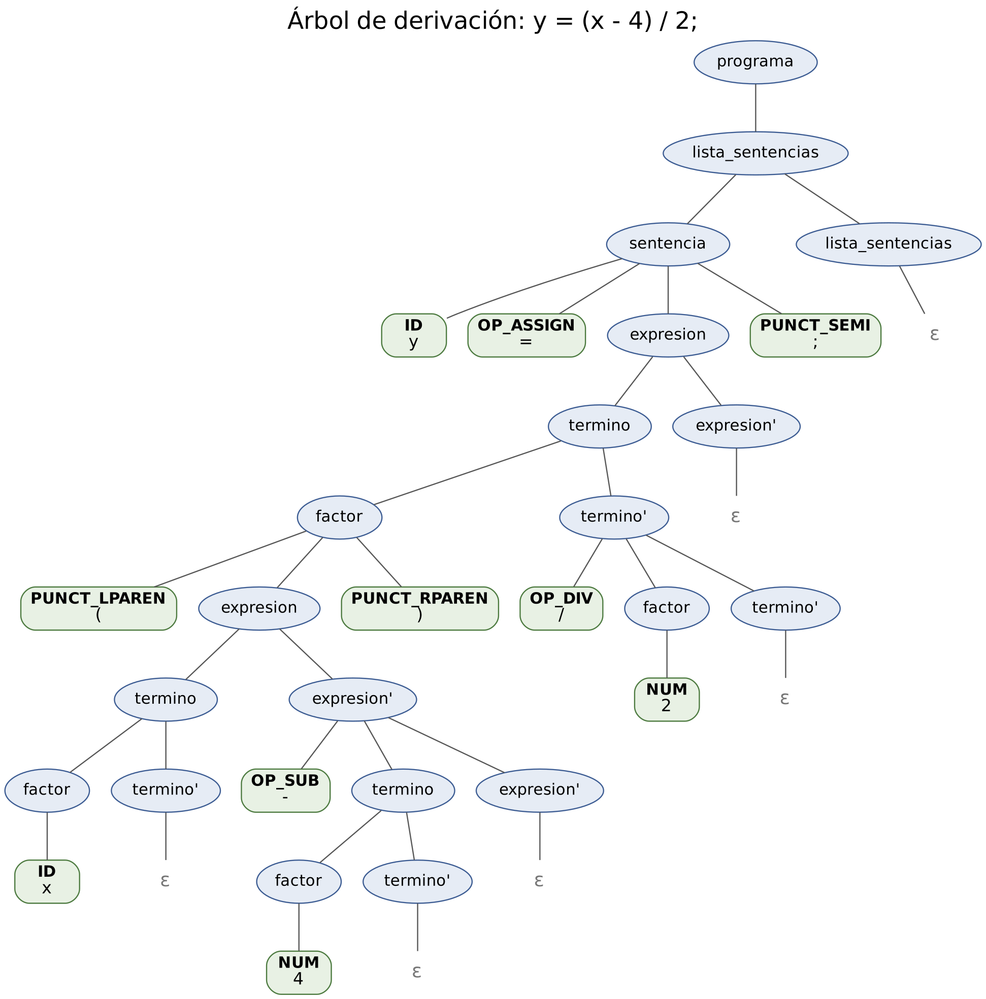

# Gramática sin recursión por la izquierda (Mini-Calc)

Teoría de Autómatas · UNIDA · Compilador minimalista Mini-Calc

## 1. Gramática original (la del enunciado)

```
programa         → lista_sentencias
lista_sentencias → sentencia lista_sentencias | ε
sentencia        → ID OP_ASSIGN expresion PUNCT_SEMI
                 | KW_PRINT expresion PUNCT_SEMI
expresion        → expresion OP_ADD termino
                 | expresion OP_SUB termino
                 | termino
termino          → termino OP_MUL factor
                 | termino OP_DIV factor
                 | factor
factor           → PUNCT_LPAREN expresion PUNCT_RPAREN | ID | NUM
```

## 2. Por qué se quita la recursión por la izquierda

Un analizador descendente recursivo tiene una función por cada no terminal. Con la regla
`expresion → expresion OP_ADD termino`, la función `expresion()` tendría que llamarse a sí
misma como primer paso, sin haber consumido ningún token. Eso produce una recursión infinita.
Lo mismo ocurre con `termino → termino OP_MUL factor`.

La transformación estándar es: toda regla `A → Aα | β` se reescribe como
`A → β A'` y `A' → α A' | ε`.

- En `expresion`: α = `OP_ADD termino` o `OP_SUB termino`, β = `termino`.
- En `termino`: α = `OP_MUL factor` o `OP_DIV factor`, β = `factor`.

## 3. Gramática transformada

```
programa         → lista_sentencias
lista_sentencias → sentencia lista_sentencias | ε
sentencia        → ID OP_ASSIGN expresion PUNCT_SEMI
                 | KW_PRINT expresion PUNCT_SEMI
expresion        → termino expresion'
expresion'       → OP_ADD termino expresion'
                 | OP_SUB termino expresion'
                 | ε
termino          → factor termino'
termino'         → OP_MUL factor termino'
                 | OP_DIV factor termino'
                 | ε
factor           → PUNCT_LPAREN expresion PUNCT_RPAREN | ID | NUM
```



## 4. Conjuntos PRIMERO y SIGUIENTE

`EOF` marca el fin de la entrada (en la teoría se escribe `$`).

| No terminal      | PRIMERO                   | SIGUIENTE                                                    |
|------------------|---------------------------|--------------------------------------------------------------|
| programa         | { ID, KW_PRINT, ε }       | { EOF }                                                      |
| lista_sentencias | { ID, KW_PRINT, ε }       | { EOF }                                                      |
| sentencia        | { ID, KW_PRINT }          | { ID, KW_PRINT, EOF }                                        |
| expresion        | { PUNCT_LPAREN, ID, NUM } | { PUNCT_SEMI, PUNCT_RPAREN }                                 |
| expresion'       | { OP_ADD, OP_SUB, ε }     | { PUNCT_SEMI, PUNCT_RPAREN }                                 |
| termino          | { PUNCT_LPAREN, ID, NUM } | { OP_ADD, OP_SUB, PUNCT_SEMI, PUNCT_RPAREN }                 |
| termino'         | { OP_MUL, OP_DIV, ε }     | { OP_ADD, OP_SUB, PUNCT_SEMI, PUNCT_RPAREN }                 |
| factor           | { PUNCT_LPAREN, ID, NUM } | { OP_MUL, OP_DIV, OP_ADD, OP_SUB, PUNCT_SEMI, PUNCT_RPAREN } |



**La gramática es LL(1).** En cada no terminal con varias alternativas, los conjuntos PRIMERO
no se superponen. Y en los que pueden derivar ε (`lista_sentencias`, `expresion'`, `termino'`),
el PRIMERO de las otras alternativas no se superpone con el SIGUIENTE. Por eso alcanza con mirar
un solo token para decidir qué regla aplicar.

## 5. Precedencia y asociatividad

- **Precedencia:** la multiplicación y la división quedan más profundas en el árbol (en `termino`),
  por eso se resuelven antes que la suma y la resta (en `expresion`).
- **Asociatividad por la izquierda:** se consigue recorriendo `expresion'` y `termino'` de izquierda
  a derecha. Por ejemplo, `10 - 4 - 2` se evalúa como `(10 - 4) - 2`.

## 6. Relación con el código

Cada no terminal es una función del parser (`src/`). Las reglas `expresion'` y `termino'`
se implementan como un `while`, y la condición del bucle sale del PRIMERO:

- `expresion_prima()` repite mientras el token sea `OP_ADD` u `OP_SUB`; con `PUNCT_SEMI` o `PUNCT_RPAREN` elige ε.
- `termino_prima()` repite mientras el token sea `OP_MUL` u `OP_DIV`; con cualquier otro elige ε.
- `lista_sentencias()` repite mientras el token sea `ID` o `KW_PRINT`; con `EOF` elige ε.

## 7. Derivación más a la izquierda de `x = 10 + 5 * 2;`

```
programa
⇒ lista_sentencias
⇒ sentencia lista_sentencias
⇒ ID OP_ASSIGN expresion PUNCT_SEMI lista_sentencias
⇒ ID OP_ASSIGN termino expresion' PUNCT_SEMI lista_sentencias
⇒ ID OP_ASSIGN factor termino' expresion' PUNCT_SEMI lista_sentencias
⇒ ID OP_ASSIGN NUM termino' expresion' PUNCT_SEMI lista_sentencias
⇒ ID OP_ASSIGN NUM expresion' PUNCT_SEMI lista_sentencias                   (termino' → ε)
⇒ ID OP_ASSIGN NUM OP_ADD termino expresion' PUNCT_SEMI lista_sentencias
⇒ ID OP_ASSIGN NUM OP_ADD factor termino' expresion' PUNCT_SEMI lista_sentencias
⇒ ID OP_ASSIGN NUM OP_ADD NUM termino' expresion' PUNCT_SEMI lista_sentencias
⇒ ID OP_ASSIGN NUM OP_ADD NUM OP_MUL factor termino' expresion' PUNCT_SEMI lista_sentencias
⇒ ID OP_ASSIGN NUM OP_ADD NUM OP_MUL NUM termino' expresion' PUNCT_SEMI lista_sentencias
⇒ ID OP_ASSIGN NUM OP_ADD NUM OP_MUL NUM expresion' PUNCT_SEMI lista_sentencias   (termino' → ε)
⇒ ID OP_ASSIGN NUM OP_ADD NUM OP_MUL NUM PUNCT_SEMI lista_sentencias              (expresion' → ε)
⇒ ID OP_ASSIGN NUM OP_ADD NUM OP_MUL NUM PUNCT_SEMI                               (lista_sentencias → ε)
```

## 8. Árboles de derivación

Con la gramática ya transformada. Los rectángulos verdes son tokens y ε indica una producción vacía.

**`x = 10 + 5 * 2;`** — se ve la precedencia: `5 * 2` se agrupa dentro de un `termino` antes de sumarse a `10`.



**`y = (x - 4) / 2;`**


